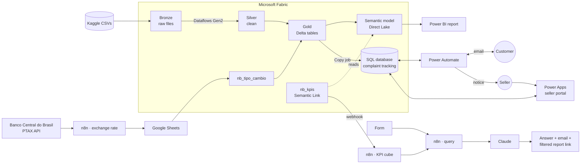
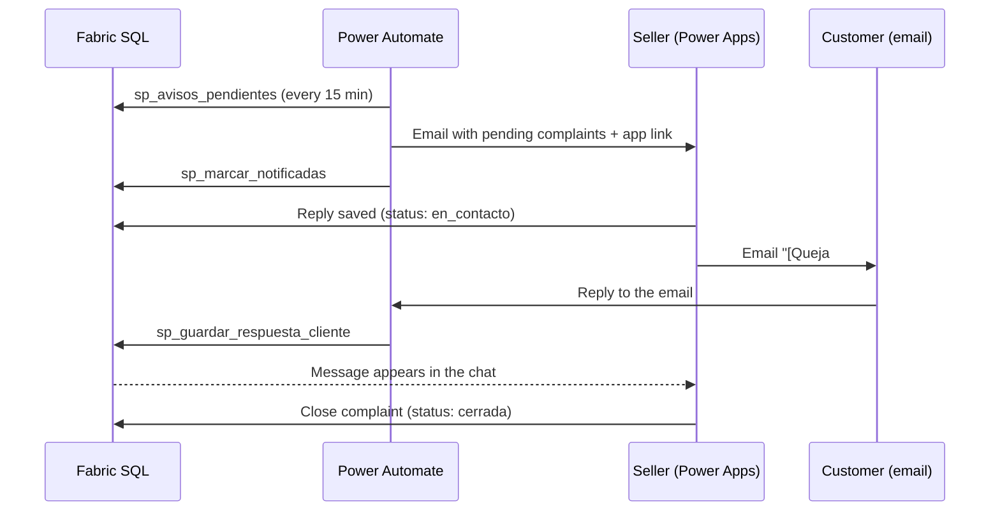
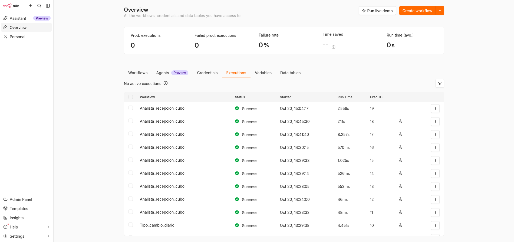

# Enterprise Data Automation


An end-to-end business intelligence system built on the [Brazilian E-Commerce Public Dataset by Olist](https://www.kaggle.com/datasets/olistbr/brazilian-ecommerce): ~100,000 real orders (2016–2018) across 9 related tables.

> **Business question:** Why do some customers rate their orders poorly, and which sellers and categories cause the most delays?

The project answers it in four steps:

| Step | What happens | Tools |
|---|---|---|
| **1. Explore** | Clean the data and prototype the dashboard | Excel, Power Query, Power Pivot, Python |
| **2. Measure** | Medallion lakehouse and executive report | Fabric, Dataflows Gen2, Power BI (Direct Lake), DAX |
| **3. Act** | Sellers get notified of bad reviews and chat with the customer by email | Fabric SQL, Power Automate, Power Apps |
| **4. Explain** | Ask questions in natural language and get a data-grounded diagnosis | n8n, Fabric notebooks, Semantic Link, Claude |

---

## Key findings

- **Delays destroy satisfaction:** on-time orders average **~4.3★**; orders 6–15 days late fall to **~1.8★**.
- **Growth hurt punctuality:** sales rose from R$ 6.16 M (2017) to R$ 7.39 M (Jan–Aug 2018) while late deliveries went from **6.6% to 9.3%**.
- **Feb–Mar 2018 was the crisis:** late deliveries hit **16% and 21.4%** nationwide, and ratings dropped to **3.83 and 3.75**.
- **The problem is geographic:** the North and Northeast concentrate delays (Alagoas **23.2%** in 2018; Maranhão and Ceará above 20%).

[See all findings ↓](#6-findings)

---

## Architecture



---

## Contents

1. [Exploration in Excel](#1-exploration-in-excel)
2. [Fabric Lakehouse and Power BI report](#2-fabric-lakehouse-and-power-bi-report)
3. [Seller portal: chat with the customer](#3-seller-portal-chat-with-the-customer)
4. [AI analyst: n8n + Claude](#4-ai-analyst-n8n--claude)
5. [Challenges and how they were solved](#5-challenges-and-how-they-were-solved)
6. [Findings](#6-findings)
7. [Repository structure](#7-repository-structure)
8. [Reproducing the project](#8-reproducing-the-project)

---

## 1. Exploration in Excel

**Goal:** understand the data and prototype the dashboard before building the cloud solution.

- **Power Query:** cleaning of the 9 tables — date types fixed, duplicates removed, and inconsistent dates flagged (e.g. a delivery dated before the purchase). Calculated columns: `delivery_days`, `delay_days`, `is_late_delivery`.
- **Prototype dashboard:** KPIs, date and state slicers, one chart per business question.

<p align="center"></p>

<details>
<summary>Power Query & Dynamic Tables screenshots</summary>

<p align="center"></p>
<p align="center"></p>
<p align="center"></p>
<p align="center"></p>

</details>

**Files:** [M code](Appx/Excel/excel_power_query.txt) · [Excel workbook](analysis/) · [Python EDA notebook](analysis/data_eda.ipynb)

---

## 2. Fabric Lakehouse and Power BI report

**Goal:** move the prototype to a medallion architecture in Microsoft Fabric and publish the executive report.

### Lakehouse (medallion)

| Layer | Content |
|---|---|
| **Bronze** | The 9 Kaggle CSVs as-is, in `Files/bronze/` |
| **Silver** | Cleaned with **Dataflows Gen2**, reusing the Power Query logic from the Excel prototype |
| **Gold** | Model-ready Delta tables, including a `calendar` table |

<p align="center"></p>
<p align="center"></p>

### Semantic model

- **Direct Lake** mode on top of the gold layer.
- **Many-to-one relationships with single filter direction.** Measures that need to filter "upward" enable `CROSSFILTER` only inside their own calculation, keeping the model predictable.
- **DAX measures:** sales, average ticket, unique customers (via `customer_unique_id`), % late deliveries, delivery days, average rating and — added in part 4 — **Sales USD**.

<p align="center"></p>

### Executive report

<p align="center"></p>

<details>
<summary>Dataflow screenshots</summary>

<p align="center"></p>
<p align="center"></p>
<p align="center"></p>
<p align="center"></p>
<p align="center"></p>

</details>

**Files:** [DAX measures and relationships](Appx/Fabric/measures_dax.txt) · [Dataflow M code](Appx/Fabric/dataflow_fabric_power_query.txt) · [Report (PDF)](Appx/Fabric/Reporte.pdf)

---

## 3. Seller portal: chat with the customer

**Goal:** go from *measuring* bad reviews to *handling* them. When a seller gets a 1★ or 2★ review, they are notified automatically and can contact the customer from an app.



### 3.1 Tracking tables (SQL database in Fabric)

| Table | Contents |
|---|---|
| `vendedor_contacto` | Demo sellers and their email |
| `seguimiento_resenas` | One row per 1–2★ review and seller: status, reply, dates |
| `interacciones` | Chat messages between seller and customer |

Complaint lifecycle: `sin_respuesta` (no reply) → `en_contacto` (in contact) → `cerrada` (closed).

Data arrives through a **Copy job** from the Lakehouse into staging tables, then is filtered and joined in T-SQL. **Stored procedures** encapsulate every read and write, so the flows never build queries themselves.

<p align="center"></p>
<p align="center"></p>

> **Simulated contacts:** Olist does not include seller or customer emails. The demo uses the 5 sellers with the most bad reviews (1,376 complaints in total) and `+` aliases of a single mailbox, such as `account+vendedor1@gmail.com`.

**Files:** [Table definitions](Appx/Fabric/tablas_seguimiento_sql.txt) · [Stored procedures](Appx/Fabric/procedimientos_tablas_seguimiento_sql.txt)

### 3.2 Notifications and emails (Power Automate)

| Flow | Trigger | What it does |
|---|---|---|
| **Seller notice** | Scheduled, every 15 minutes | One email per seller with their pending complaints and the app link; marks them as notified |
| **Customer reply** | Incoming email with `[Queja #` in the subject | Extracts the complaint number from the subject and saves the reply in `interacciones` |

<p align="center"></p>

<details>
<summary>Flow screenshots</summary>

<p align="center"></p>
<p align="center"></p>
<p align="center"></p>
<p align="center"></p>

</details>

**Files:** [Flow expressions](Appx/Automate/fx_expressions_used_in_flows.txt)

### 3.3 Seller app (Power Apps)

Canvas app with three screens:

| Screen | Purpose |
|---|---|
| **List** | The seller's complaints, filtered by status |
| **Detail** | The full complaint and the button to reply |
| **Chat** | The email conversation rendered as a chat, plus the button to close the complaint |

<p align="center"></p>
<p align="center"></p>
<p align="center"></p>

<details>
<summary>The full cycle from three sides: customer inbox, monitored mailbox and database</summary>

<p align="center"></p>
<p align="center"></p>
<p align="center"></p>

</details>

<details>
<summary>More app and database screenshots</summary>

<p align="center"></p>
<p align="center"></p>
<p align="center"></p>
<p align="center"></p>
<p align="center"></p>

</details>

---

## 4. AI analyst: n8n + Claude

**Goal:** let anyone ask questions about the data in natural language and get a diagnosis grounded in the model's numbers.

### 4.1 Program 1 — Daily exchange rate

Olist sales are in Brazilian reais (BRL). To report them in dollars, n8n fetches the official **PTAX** rate from the Banco Central do Brasil.

```
BCB API (11:00) → n8n → Google Sheets → nb_tipo_cambio (12:00) → Lakehouse → Direct Lake model
```

- **Historical load:** run once; loaded 750 daily rates for 2016–2018.
- **Daily load:** Monday to Friday, appends the day's rate.
- **`Ventas USD` measure:** divides each day's sales by that day's rate; weekends and holidays use the last business day's rate.

<p align="center"></p>

<details>
<summary>Workflow, notebook and model screenshots</summary>

<p align="center"></p>
<p align="center"></p>
<p align="center"></p>
<p align="center"></p>
<p align="center"></p>
<p align="center"></p>

</details>

**Files:** [DAX measure](Appx/n8n/Program1/MedidaDAX.txt) · [Historical workflow](Appx/n8n/Program1/Tipo_cambio_carga_historica.json) · [Daily workflow](Appx/n8n/Program1/Tipo_cambio_diario.json) · [Notebook](Appx/n8n/Program1/nb_tipo_cambio.html)

### 4.2 Program 2 — Claude analyst

```
pl_diario (12:00, Mon–Fri) → nb_tipo_cambio → nb_kpis (DAX via Semantic Link)
  → n8n webhook (POST + X-Api-Key) → cubo_olist (Google Sheets)

Form → n8n query workflow → Claude → on-screen answer + email + link to the filtered report
```

**1. A KPI cube built from components.** The `nb_kpis` notebook does not send pre-computed percentages; it sends their **components** (sales, orders, late deliveries, total deliveries, rating sum, review count…) in two tables: *state × month* and *category × month*. n8n can then recompute any KPI for any combination of filters correctly — averaging pre-computed percentages would not.

**2. Always in sync with the model.** The `pl_diario` pipeline runs `nb_tipo_cambio` and then `nb_kpis`, so the cube is never older than the model. Every answer states the data cut-off date.

<p align="center"></p>

**3. The query.** The user picks state, year, category, KPIs and analysis type (executive summary, year-over-year comparison or problem detection), writes a free-text question and leaves an email. n8n filters the cube, recomputes the KPIs, builds the context for Claude and generates a link to the Power BI report **already filtered**.

<p align="center"></p>

> The model node appears deactivated in the screenshot and JSON because the API key was removed before exporting.

**4. The answer.** Claude is instructed to use **only** the data in the JSON and never invent causes or figures. Asked *"Why did the rating drop in São Paulo?"*, Claude **challenged the premise**: SP's yearly rating actually rose from 4.15 to 4.19. It then identified the real dip in February–March 2018 and tied it to the spike in late deliveries.

<p align="center">
  
  &nbsp;&nbsp;
  
</p>

<details>
<summary>Pipeline and cube intake screenshots</summary>

<p align="center"></p>
<p align="center"></p>
<p align="center"></p>

</details>

**Files:** [Cube intake workflow](Appx/n8n/Program2/Analista_recepcion_cubo.json) · [Query workflow](Appx/n8n/Program2/Analista_consulta.json) · [nb_kpis notebook](Appx/n8n/Program2/nb_kpis.html)

---

## 5. Challenges and how they were solved

| Challenge | Solution |
|---|---|
| The Lakehouse SQL endpoint is **read-only**, so the app and flows couldn't write complaint status or messages. | Created a separate **Fabric SQL database**, loaded via Copy job, with stored procedures for every read/write. |
| Olist has **no seller or customer emails**. | Simulated contacts with `+` aliases of a single mailbox for the 5 sellers with the most complaints. |
| Linking a customer's email reply to the right complaint. | The complaint ID travels in the subject (`[Queja #123]`); the flow extracts it with an expression and stores the reply. |
| A **Direct Lake** model can only read OneLake tables, not Google Sheets. | The `nb_tipo_cambio` notebook copies the exchange-rate sheet into the Lakehouse daily. |
| No exchange rate on **weekends and holidays**. | The `Ventas USD` measure falls back to the last business day's rate. |
| The Power BI REST API needs an **Entra app registration**, blocked by the university tenant. | Inverted the direction: a Fabric notebook reads the model with **Semantic Link** under the user's session and **pushes** the data to an n8n webhook protected by `X-Api-Key`. |
| Averaging pre-computed percentages gives **wrong KPIs** when filters are combined. | The cube stores numerators and denominators; n8n recomputes each ratio after filtering. |
| Risk of the LLM **inventing causes or numbers**. | Claude receives only the filtered JSON, with explicit instructions to stick to it; every answer includes the data cut-off date and a link to the filtered report to verify. |

---

## 6. Findings

1. **Delays destroy satisfaction.** On-time orders average about **4.3★**; orders 6 to 15 days late drop to around **1.8★**.
2. **Punctuality got worse as the business grew.** Sales went from R$ 6.16 M in 2017 to R$ 7.39 M in 2018 (January to August), while late deliveries rose from **6.6% to 9.3%**.
3. **February and March 2018 were the crisis.** Nationwide, late deliveries reached **16% and 21.4%**, and the rating fell to **3.83 and 3.75**, the lowest of the period.
4. **The problem is geographic.** Northern and northeastern states concentrate the delays: Alagoas (**23.2%** in 2018), Maranhão and Ceará are above 20%.
5. **One category stands out as the worst.** `office_furniture` has the lowest rating in 2018, with a **3.61** average and **23.6%** negative reviews.
6. **The exchange rate changes the picture.** Measured in dollars, 2018 growth is smaller, because the real weakened from ~3.20 to ~3.50 per dollar.

---

## 7. Repository structure

```
├── kaggle_data/           # 9 original Olist CSV files
├── analysis/              # Excel prototype, Python EDA and PDF report
└── Appx/
    ├── Excel/             # Prototype Power Query and screenshots
    ├── Fabric/            # Dataflow, DAX measures, tracking SQL and screenshots
    ├── Automate/          # Flow expressions and screenshots
    ├── PowerApps/         # App and database screenshots
    └── n8n/
        ├── Program1/      # Exchange rate: workflows, notebook, DAX measure
        └── Program2/      # Claude analyst: workflows, nb_kpis notebook
```

> Some object names are in Spanish (`seguimiento_resenas`, `sin_respuesta`, `tipo_cambio`…) because they match the actual tables, columns and workflows in Fabric, SQL and n8n.

---

## 8. Reproducing the project

The cloud components depend on licensed services, so the repository contains the code, exports and screenshots needed to rebuild each part rather than a one-click deployment.

| Part | What you need | How |
|---|---|---|
| Exploration | Excel (Microsoft 365) or Python | Open the workbook in `analysis/` or run `data_eda.ipynb` against `kaggle_data/` |
| Lakehouse + report | Microsoft Fabric workspace | Upload the CSVs to `Files/bronze/`, recreate the Dataflow from its M code, then build the model with `measures_dax.txt` |
| Seller portal | Fabric SQL database, Power Automate, Power Apps | Run the table and procedure scripts, then recreate the two flows using the expressions file |
| AI analyst | n8n, Google Sheets, an Anthropic API key | Import the JSON workflows, add your own credentials and API key, and schedule the notebooks in Fabric |

---

**Data license:** the dataset belongs to Olist and is published on Kaggle under [CC BY-NC-SA 4.0](https://creativecommons.org/licenses/by-nc-sa/4.0/).
